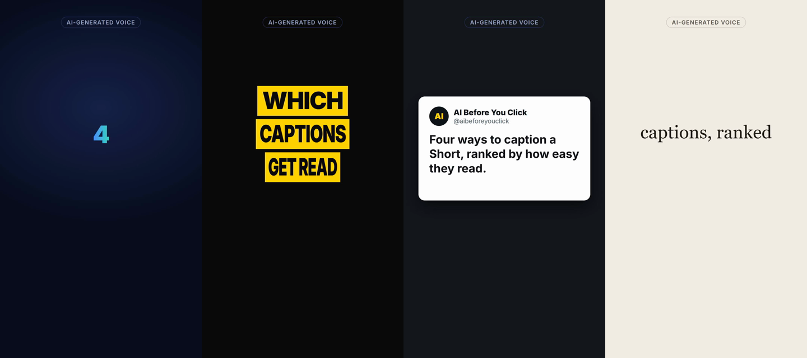
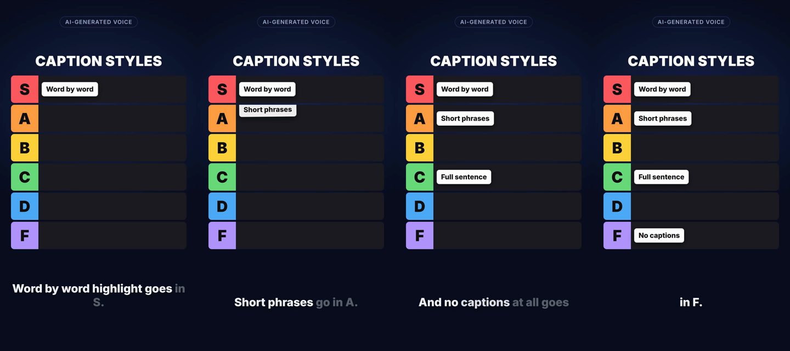
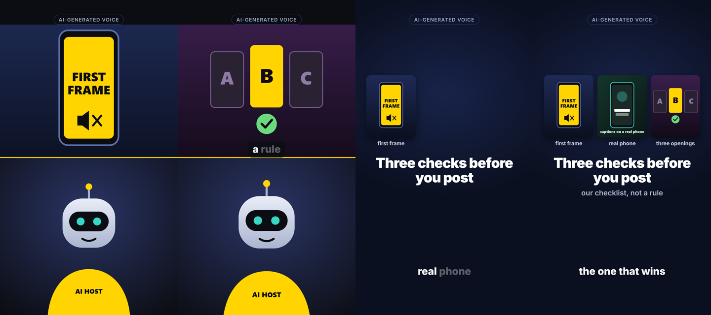

# shorts-layouts

Four reusable layouts for faceless 9:16 Shorts, each packaged as a Claude Code skill: attach a script, call `/trial-reels`, `/ranking-list`, `/storytelling` or `/split-screen`, render. Everything runs locally; no paid service, no upload.

| Layout | What it does |
|---|---|
| `/trial-reels` | 3 visually different openings (headline, post card, minimal) of the same short, for trial reels and A/B tests. Same voice and body; only the hook screen changes. |
| `/ranking-list` | An S-to-F tier board. Each card drops into its row on the word the narrator says. |
| `/storytelling` | Three images, a title and a subtitle; each image pops in on its spoken word. |
| `/split-screen` | Visuals on top, a host image below (slow zoom), captions on the seam; the top visual swaps on spoken words. |





## How it works
`examples/<slug>/script.json` (narration lines per phase, sources, layout blocks)
→ `tools/tts.py` (Kokoro TTS, word timestamps)
→ `tools/build_data.py` (`data.js`: words, caption phrases, phase times)
→ a layout tool (`tools/trial_reels.py`, `ranking_list.py`, `storytelling.py`, `split_screen.py`)
→ `hyperframes check` → `hyperframes render`.

Every animation is anchored to a spoken word, never to fixed seconds, so editing a line and re-running keeps everything in sync. Each layout tool validates its block (counts, word limits, that every anchor word is actually spoken in that phase, that image files exist), copies a small runtime from `tools/layouts/` into the video folder and adds two `<script>` tags to `index.html`. Running it twice changes nothing.

## Setup
Requirements: Python 3.10+, Node 22+ (HyperFrames requires it), and what `npx hyperframes doctor` reports as missing (it checks Chrome and ffmpeg).
```
npm install --ignore-scripts
python -m venv .venv
.venv/bin/pip install -r requirements.txt        # Windows: .venv\Scripts\pip
```
GSAP is not included in this repo (see THIRD_PARTY.md). Copy it into each video folder after `npm install`:
```
cp node_modules/gsap/dist/gsap.min.js examples/layout-check/vendor/
cp node_modules/gsap/dist/gsap.min.js examples/layout-check-2/vendor/
```
Turn off HyperFrames telemetry for every run: `HYPERFRAMES_NO_TELEMETRY=1` and `DO_NOT_TRACK=1`.

## Render an example
The examples already contain narration and timings, so no TTS is needed to try them:
```
cd examples/layout-check
npx --no-install hyperframes check
npx --no-install hyperframes render -o out/layout-check.mp4
npx --no-install hyperframes render --variables '{"trial":"A"}' -o out/layout-check-A.mp4
```

## Make your own
```
python -I tools/check_script.py examples/<slug>     # sources, privacy line, spelled-out numbers
python -I tools/tts.py examples/<slug>              # narration.wav, transcript.json, timings.json
python -I tools/build_data.py examples/<slug>       # data.js, captions.srt
python -I tools/ranking_list.py examples/<slug>     # or trial_reels / storytelling / split_screen
python -I tools/check_script.py examples/<slug>     # again: speaking rate per phase
```
Block formats are in each tool's docstring and in `docs/SPEC.md`. With Claude Code, open this folder and call the skill by name; the skill files in `.claude/skills/` walk through the same steps and tell Claude to look at rendered frames before reporting.

## Channel rules the tools enforce
- Every claim in `script.json` has a source in `sources`. No source, no claim.
- A `privacy` line that is actually spoken.
- Numbers spelled out in narration; speaking rate at most 3 words per second per phase.
- An "AI-GENERATED VOICE" label stays visible over every layout.
- Images are your own (drawn, generated or your own screenshots), never someone else's media.
- Nothing here publishes anything.

## Tests
```
python -I -m unittest discover -s tests -v
```
The tests cover the layout tools and checks (standard library only). TTS and rendering are not covered by the tests.

## Limits
- Tested on Windows 11 with HyperFrames 0.8.147; other platforms are expected to work but were not tested locally.
- `/split-screen` takes images only (no video host yet).
- Kokoro downloads its model from Hugging Face on first run.

License: MIT (code). Third-party components keep their own licenses: THIRD_PARTY.md.
